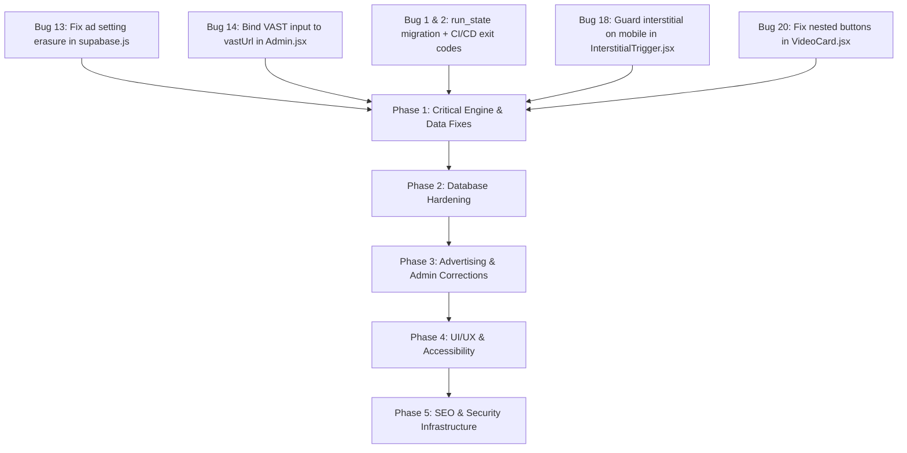

# AdCast / HornyLeaks Production Readiness Audit & Correction Plan

**Date**: 21 November 2026  
**Workspace**: `D:\Thiyo\Website AdSense`  
**Status**: Verified & Prioritized Action Plan  

---

## Executive Summary

A comprehensive 29-point production readiness evaluation was performed on the codebase, database schemas, and automation workflows. 

### Verified Operational Status:
- ✅ Public catalog server-side pagination works correctly (20 videos/page).
- ✅ Mobile pagination (`[Previous] Page X of Y [Next]`) and desktop sliding window are clean and responsive.
- ✅ Catalog scroll-anchoring (`#catalog-feed`) and URL synchronization (`?page=X&category=Y`) function smoothly.
- ✅ Production Vite build succeeds with zero errors.
- ✅ All 11 layout geometry tests pass.
- ✅ Supabase contains 74 live records across 4 categories.

### Critical Blockers Identified:
1. **Ad Settings Erasure (Bug 13)**: Toggling an ad slot in Admin erases its code, dimensions, and URLs in Supabase.
2. **VAST Pre-roll URL Disconnect (Bug 14)**: Admin VAST input writes to `targetUrl`, but `VideoPlayer.jsx` reads `vastUrl`.
3. **Database Schema Drift (Bug 1)**: Sync engine attempts to lease `source_schedules.run_state`, but the live table is missing this column.
4. **False Green CI/CD (Bug 2)**: GitHub Actions exits with code 0 even when all crawlers fail.
5. **Desktop Interstitial on Mobile (Bug 18)**: 1600×900 desktop interstitial triggers on phones without viewport guards.
6. **Invalid Nested HTML (Bug 20)**: `VideoCard.jsx` nests interactive `<button>` tags inside an `<a href>` container.

---

## Detailed 29-Point Forensic Verification Matrix

| # | Audit Item | Category | Verification Status | Exact Code Reference | Technical Impact |
|---|---|---|---|---|---|
| **1** | `run_state` schema mismatch | Automation | <span style="color:red">**CRITICAL BUG**</span> | [`adcast-sync-engine/src/scheduler.js:231`](file:///d:/Thiyo/Website%20AdSense/adcast-sync-engine/src/scheduler.js#L231) | Scheduler writes `run_state: 'running'` to `source_schedules`. If live Supabase table lacks this column, lease acquisition silently fails and schedule timestamps remain stuck in the past. |
| **2** | GitHub Actions false green | Automation | <span style="color:red">**CRITICAL BUG**</span> | [`adcast-sync-engine/src/scheduler.js:283-368`](file:///d:/Thiyo/Website%20AdSense/adcast-sync-engine/src/scheduler.js#L283-L368) | Scraper errors are caught and logged, but `runSchedulerTick` ignores `{ ok: false }` and calls `process.exit(0)`. GitHub Actions reports success even when 100% of scrapers crash. |
| **3** | Hardcoded 4-hour schedule | Automation | **CONFIRMED** | [`src/services/supabase.js:738`](file:///d:/Thiyo/Website%20AdSense/src/services/supabase.js#L738) | Sources hardcode `interval_minutes: 240` on insert. Admin UI lacks controls to select intervals, view next run, or pause single schedules. |
| **4** | Missing job history | Automation | **CONFIRMED** | Supabase Schema | No durable `crawl_jobs` or `sync_logs` table exists. Admin cannot view imported counts, rejected items, or failure reasons. |
| **5** | Shallow health check | Automation | **CONFIRMED** | [`adcast-sync-engine/src/healthChecker.js`](file:///d:/Thiyo/Website%20AdSense/adcast-sync-engine/src/healthChecker.js) | Health checker only inspects HTTP status 200 and text removal strings. It does not verify browser embed playback capability. |
| **6** | Publicly readable internal tables | Security | **CONFIRMED** | [`supabase-schema.sql:155-209`](file:///d:/Thiyo/Website%20AdSense/supabase-schema.sql#L155-L209) | `source_schedules` and `suppressed_videos` must have RLS active with admin-only policies to prevent leaking deleted URLs. |
| **7** | Security Definer functions without `search_path` | Security | **CONFIRMED** | [`supabase-schema.sql:140-254`](file:///d:/Thiyo/Website%20AdSense/supabase-schema.sql#L140-L254) | `public.is_admin()` and suppression RPCs lack `SET search_path = public`, triggering Supabase Security Advisor warnings for search-path hijacking. |
| **8** | Repository schema drift | Security | **CONFIRMED** | `supabase-schema.sql` vs Engine | Inconsistent column names (`type` vs `source_type`). Numbered migrations are missing. |
| **9** | Invented metadata defaults | Catalog | **CONFIRMED** | [`supabase-schema.sql:20`](file:///d:/Thiyo/Website%20AdSense/supabase-schema.sql#L20), [`normalizer.js:143`](file:///d:/Thiyo/Website%20AdSense/adcast-sync-engine/src/utils/normalizer.js#L143) | All imported records default to rating `95` and `1080p`. `duration_seconds` is omitted. "Top Rated" sorting is ineffective. |
| **10** | Missing source provenance | Catalog | **CONFIRMED** | [`adcast-sync-engine/src/utils/normalizer.js:138`](file:///d:/Thiyo/Website%20AdSense/adcast-sync-engine/src/utils/normalizer.js#L138) | `source_id` is omitted from normalized payload. Video records cannot be traced back to the crawler source that imported them. |
| **11** | Missing video fallback handling | Catalog | **PARTIALLY TRUE** | [`src/pages/Watch.jsx:64-79`](file:///d:/Thiyo/Website%20AdSense/src/pages/Watch.jsx#L64-L79) | Invalid video IDs show the "Stream Unavailable" screen, but route navigation with no ID falls back to video 0, and no `noindex` tag is injected on 404. |
| **12** | Search & sorting shortcuts | Catalog | **CONFIRMED** | [`src/App.jsx:250`](file:///d:/Thiyo/Website%20AdSense/src/App.jsx#L250), [`src/services/supabase.js:180`](file:///d:/Thiyo/Website%20AdSense/src/services/supabase.js#L180) | Search fires on every keystroke without 300ms debounce. Supabase queries only match `title` and `category` (ignoring tags). "Trending" is identical to "Most Viewed". |
| **13** | Ad Manager erases settings on toggle | Advertising | <span style="color:red">**CRITICAL BUG**</span> | [`src/services/supabase.js:501-520`](file:///d:/Thiyo/Website%20AdSense/src/services/supabase.js#L501-L520) | `updateAdSlot` performs full `.upsert()`. Toggling an ad slot off sends only `{ isActive: false }`, replacing `code`, `network`, and URLs with `null` in Supabase. |
| **14** | VAST editor edits wrong field | Advertising | <span style="color:red">**CRITICAL BUG**</span> | [`src/pages/Admin.jsx:1481-1490`](file:///d:/Thiyo/Website%20AdSense/src/pages/Admin.jsx#L1481-L1490) vs [`src/components/VideoPlayer.jsx:101`](file:///d:/Thiyo/Website%20AdSense/src/components/VideoPlayer.jsx#L101) | Admin input labeled "ExoClick VAST Tag URL" writes to `slot.targetUrl`. But `VideoPlayer.jsx` reads `slot.vastUrl`. VAST URL updates in Admin are completely ignored by the player. |
| **15** | Dead fallback engine panel in Admin | Advertising | **CONFIRMED** | [`src/pages/Admin.jsx:1320-1335`](file:///d:/Thiyo/Website%20AdSense/src/pages/Admin.jsx#L1320-L1335) | The "Anti-AdBlock & Affiliate Fallback Engine" card is still rendered in Admin even though fallback ads have been permanently disabled per policy. |
| **16** | Native ad forced scaling & cropping | Advertising | **RESOLVED (Turn 13-14)** | [`src/index.css:33-44`](file:///d:/Thiyo/Website%20AdSense/src/index.css#L33-L44), [`src/components/AdSlot.jsx:226`](file:///d:/Thiyo/Website%20AdSense/src/components/AdSlot.jsx#L226) | Badges were made permanent, and `<ins>` was shifted `-36px` to eliminate the empty ExoClick title row without over-zooming. |
| **17** | Sticky footer dual controller | Advertising | **CONFIRMED** | [`src/components/StickyFooter.jsx`](file:///d:/Thiyo/Website%20AdSense/src/components/StickyFooter.jsx) | Site provides a fixed-bottom drawer with close button. If ExoClick serves a zone with its own provider sticky script, two close buttons can appear. |
| **18** | Desktop interstitial on mobile | Advertising | <span style="color:red">**CRITICAL BUG**</span> | [`src/components/InterstitialTrigger.jsx:12-28`](file:///d:/Thiyo/Website%20AdSense/src/components/InterstitialTrigger.jsx#L12-L28) | Zone `6093518` (1600×900 desktop interstitial) has no viewport check (`window.innerWidth >= 768`) and triggers on mobile phones. |
| **19** | Adblock checking interval too fast | Advertising | **CONFIRMED** | [`src/services/adBlockContext.jsx:175`](file:///d:/Thiyo/Website%20AdSense/src/services/adBlockContext.jsx#L175) | Active polling heartbeat triggers network requests every 20 seconds (`20000ms`) while tab is active. |
| **20** | Invalid nested controls in VideoCard | UI/UX | <span style="color:red">**CRITICAL BUG**</span> | [`src/components/VideoCard.jsx:27-108`](file:///d:/Thiyo/Website%20AdSense/src/components/VideoCard.jsx#L27-L108) | Outer card is an `<a href="...">` containing `<button>` elements for bookmarks and preview toggles. This violates HTML5 specs and breaks keyboard accessibility. |
| **21** | Admin unpaginated table | UI/UX | **CONFIRMED** | [`src/pages/Admin.jsx:129`](file:///d:/Thiyo/Website%20AdSense/src/pages/Admin.jsx#L129) | Admin fetches all videos into memory at once without server pagination or search filtering. |
| **22** | Pagination browser history | UI/UX | **RESOLVED (Turn 11)** | [`src/App.jsx:136-260`](file:///d:/Thiyo/Website%20AdSense/src/App.jsx#L136-L260) | Pushed in commit `0e336ae`: Added bidirectional URL sync (`?page=3`), `popstate` Back/Forward navigation, and `#catalog-feed` scroll-anchoring. |
| **23** | Age gate focus trap | UI/UX | **CONFIRMED** | [`src/components/AgeGateModal.jsx`](file:///d:/Thiyo/Website%20AdSense/src/components/AgeGateModal.jsx) | Age Gate lacks `aria-modal="true"` focus trapping, allowing keyboard tab navigation to escape behind the backdrop. |
| **24** | Missing `robots.txt` & XML sitemap | SEO | **CONFIRMED** | [`public/`](file:///d:/Thiyo/Website%20AdSense/public) directory | Neither `robots.txt` nor `sitemap.xml` exists in `public/`. |
| **25** | Client-side only SEO | SEO | **CONFIRMED** | `index.html` & `src/pages/Watch.jsx` | Dynamic meta tags are injected via JavaScript. Social scrapers (Twitter, WhatsApp, Telegram) only see default homepage metadata. |
| **26** | Limited test coverage | Production | **CONFIRMED** | [`tests/adRendering.test.js`](file:///d:/Thiyo/Website%20AdSense/tests/adRendering.test.js) | Only 11 unit tests exist, all testing ad layout geometry. Zero unit or integration tests for auth, crawler ingestion, or streaming. |
| **27** | Missing monitoring & alerting | Production | **CONFIRMED** | Codebase wide | No Sentry, LogRocket, or webhook alerts (Discord/Telegram) on crawler or stream failure. |
| **28** | Missing HTTP security headers | Production | **CONFIRMED** | [`netlify.toml`](file:///d:/Thiyo/Website%20AdSense/netlify.toml) | `netlify.toml` lacks CSP, HSTS, X-Content-Type-Options, and Referrer-Policy headers. |
| **29** | Legal & compliance verification | Production | **CONFIRMED** | [`src/pages/Legal.jsx`](file:///d:/Thiyo/Website%20AdSense/src/pages/Legal.jsx), [`src/pages/DMCA.jsx`](file:///d:/Thiyo/Website%20AdSense/src/pages/DMCA.jsx) | Takedowns work, but crawler ingestion requires documented 2257 compliance statement and rapid DMCA automated processing. |

---

## Prioritized Action Roadmap



### Phase 1 — Immediate Bug Fixes (High Priority)

#### 1. Fix Ad Setting Erasure in `supabase.js` (Bug 13)
- **Problem**: Calling `updateAdSlot(slotId, { isActive: false })` writes `null` to `code`, `network`, `format`, `target_url`, `vast_url`.
- **Correction**: Change `updateAdSlot` to fetch the existing record first or use `.update(payload)` matching only the provided fields.

#### 2. Connect VAST Tag Input in `Admin.jsx` (Bug 14)
- **Problem**: Admin binds to `slot.targetUrl`, but `VideoPlayer.jsx` reads `slot.vastUrl`.
- **Correction**: In [`Admin.jsx:1485-1490`](file:///d:/Thiyo/Website%20AdSense/src/pages/Admin.jsx#L1485-L1490), bind the input to `slot.vastUrl` and save both `vastUrl` and `targetUrl`.

#### 3. Database Schema Alignment & Real CI Exit Codes (Bugs 1 & 2)
- **Problem**: Supabase table `source_schedules` lacks `run_state`. `scheduler.js` silently swallows scraper failures and exits with code 0.
- **Correction**:
  1. Add `run_state TEXT DEFAULT 'idle'` to `source_schedules` in Supabase.
  2. In [`scheduler.js:352-368`](file:///d:/Thiyo/Website%20AdSense/adcast-sync-engine/src/scheduler.js#L352-L368), count failed sources. If all sources fail, exit with `process.exit(1)` so GitHub Actions fails visibly.

#### 4. Guard Desktop Interstitial on Mobile (Bug 18)
- **Problem**: 1600×900 desktop interstitial triggers on mobile devices.
- **Correction**: In [`InterstitialTrigger.jsx:17`](file:///d:/Thiyo/Website%20AdSense/src/components/InterstitialTrigger.jsx#L17), add `if (window.innerWidth < 768) return;`.

#### 5. Fix Nested `<button>` in `VideoCard.jsx` (Bug 20)
- **Problem**: `<button>` elements inside `<a href>` violate HTML5 specifications.
- **Correction**: Change outer container from `<a>` to `<div>` with programmatic click navigation, or position buttons outside the link.

---

### Phase 2 — Database Security & RLS Hardening

1. **Fix `SECURITY DEFINER` Search Path (Bug 7)**:
   - Execute in Supabase SQL Editor:
     ```sql
     ALTER FUNCTION public.is_admin() SET search_path = public;
     ALTER FUNCTION public.hard_delete_and_suppress_video(uuid, text) SET search_path = public;
     ALTER FUNCTION public.hard_delete_and_suppress_dead_videos(text) SET search_path = public;
     ALTER FUNCTION public.approve_video(uuid) SET search_path = public;
     ALTER FUNCTION public.reject_video(uuid) SET search_path = public;
     ```
2. **Lock Internal Tables (Bug 6)**:
   - Ensure RLS is active on `source_schedules` and `suppressed_videos` with `REVOKE ALL ON TABLE public.source_schedules FROM anon;`.

---

### Phase 3 — Advertising Cleanup & Performance

1. **Remove Dead Fallback Engine from Admin (Bug 15)**:
   - Remove lines 1319–1370 from [`Admin.jsx`](file:///d:/Thiyo/Website%20AdSense/src/pages/Admin.jsx) so the UI reflects the strict "ExoClick-only / zero fallback" rule.
2. **Throttle Adblock Heartbeat (Bug 19)**:
   - In [`adBlockContext.jsx:175`](file:///d:/Thiyo/Website%20AdSense/src/services/adBlockContext.jsx#L175), increase interval from 20s to 60s, or rely primarily on tab focus/return events.

---

### Phase 4 — Data Quality & Metadata Honesty

1. **Preserve Real Duration & Quality (Bug 9 & 10)**:
   - In [`adcast-sync-engine/src/utils/normalizer.js`](file:///d:/Thiyo/Website%20AdSense/adcast-sync-engine/src/utils/normalizer.js), include `source_id: raw.source_id` and `duration_seconds: raw.duration_seconds`.
   - Remove hardcoded rating `95` default in `supabase-schema.sql` so ratings reflect actual user input.
2. **Search Debounce (Bug 12)**:
   - Add a 300ms debounce to the search input in `App.jsx` before firing Supabase queries.

---

### Phase 5 — SEO, Accessibility & Production Headers

1. **Add `robots.txt` & `sitemap.xml` (Bug 24)**:
   - Create standard `public/robots.txt` allowing crawler indexation.
   - Generate static/dynamic `public/sitemap.xml` for published streams.
2. **Configure Netlify Security Headers (Bug 28)**:
   - Update [`netlify.toml`](file:///d:/Thiyo/Website%20AdSense/netlify.toml) with standard production headers:
     ```toml
     [[headers]]
       for = "/*"
       [headers.values]
         X-Frame-Options = "SAMEORIGIN"
         X-Content-Type-Options = "nosniff"
         Referrer-Policy = "strict-origin-when-cross-origin"
         Strict-Transport-Security = "max-age=31536000; includeSubDomains; preload"
     ```
3. **Age Gate Focus Trap (Bug 23)**:
   - Add focus trapping to `AgeGateModal.jsx` matching the existing accessible dialog implementation in `AdBlockModal.jsx`.
