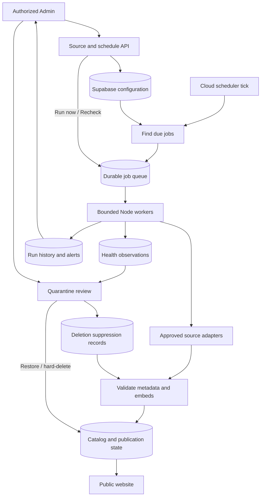

# Autonomous Video Engine: Production Design and Implementation Plan

Prepared: 18 November 2026.
Project: AdCast / HornyLeaks.
Status: proposed production specification, not a statement that these features are implemented.

Related documents:
- [Technical correction checklist](ANTIGRAVITY-CORRECTION-CHECKLIST.md)
- [UI/UX correction checklist](ANTIGRAVITY-CORRECTION-CHECKLIST-2-UI-UX.md)
- [Current engine](adcast-sync-engine/)

## 1. Product requirement agreed with the owner

The owner can save 10 or more source websites in Admin, choose import times and a timezone, and enable automatic operation. Cloud infrastructure runs the work even when the owner's computer is off. The engine discovers permitted video metadata and playable embeds, imports new records, refreshes existing records, and maintains availability.

Confirmed unavailable videos are soft-deleted from public browsing and placed in an Admin quarantine queue. The owner inspects them and chooses Recheck, Restore, or Hard-delete. The engine never permanently deletes videos automatically.

Routine operation should not require manually copying titles, configuring every source's selectors, pressing Sync, or opening a terminal. Supported sources should work after initial setup. Unsupported, protected, or changed sources need truthful exception handling rather than fake success.

### Definition of automatic

Automatic means unattended processing for compatible, authorized, validated sources within configured budgets. It does not mean unlimited crawling, guaranteed support for every website, CAPTCHA bypass, or a guarantee that every external embed works forever.

### Project boundaries

- Public frontend: discovery, search, bookmarks, playback, reports, advertisements.
- Supabase: configuration, catalog, identities, jobs, health evidence, review records.
- Import workers: source discovery, incremental imports, metadata refresh, health checks.
- Admin: controls, schedules, review, diagnostics, and explicit permanent deletion.
- External platforms: video hosting and delivery. Do not download/host/transcode entire videos as part of this project.
- Ad delivery and earnings remain a separate subsystem; import success does not prove advertisements or revenue work.

## 2. Current implementation and gaps

Observed in the current source; another implementation task is active, so recheck before changing files:

| Existing capability | Gap to production behavior |
|---|---|
| Dedicated HTML adapter, generic HTML parser, JSON API reader, RSS/MRSS parser | No dependable root-URL-to-working-adapter discovery workflow |
| Database source list and JSON fallback | Configuration fallback can mask failures; source schema/parser settings need reconciliation |
| Fixed local cron and GitHub schedule | No complete Admin-managed, per-source timezone scheduling with durable due-job recovery |
| Insert and URL duplicate checks | No complete incremental checkpoint, metadata refresh, deletion suppression, or concurrency contract |
| HTTP health checks and inactive flag | Blocking/temporary failures are not fully separated from availability, and quarantine evidence is incomplete |
| Manual dispatch endpoint | Must verify privileged authorization, requested source propagation, real run status, and failure behavior |
| Rotated user-agent/request headers | These are not a reliable Cloudflare/CAPTCHA solution |
| Console summaries | No complete persistent run history, alerts, operational metrics, or production acceptance evidence |

Earlier live checks found old ad seed records and missing database fields. Treat this as a deployment sequencing warning: modifying source/schema files does not modify the live database. Do not assume either correction checklist is completed because commits use those task names.

The supplied GitHub screenshot showed failed scheduled runs. It proves attempted execution, not the reason for failure. Read the actual failed step logs before attributing failures to credentials, dependencies, scraping, or database schema.

## 3. Recommended architecture

Use the existing React and Supabase application. Add a durable scheduling and job-processing layer; keep long-running imports out of browser requests.

### Practical implementation choice

Recommended starting design: a short Supabase Cron task finds due work and enqueues jobs; a supervised Node worker on an appropriate cloud runtime consumes them. Supabase Queues is one suitable durable queue option alongside the existing database. Verify project availability/limits before choosing it. This is an architectural recommendation, not a claim that the current project already provisions these services. [Supabase Cron](https://supabase.com/docs/guides/cron), [Supabase Queues](https://supabase.com/docs/guides/queues).

Keep frontend/Netlify functions as a control API: authorize, validate, enqueue, and respond promptly with a real job ID. They should not wait for a whole source crawl. Browser-based rendering, if justified for a permitted source, belongs in a separately isolated worker pool with explicit runtime/cost limits.

GitHub Actions can remain useful for CI, manual recovery, and an interim best-effort batch runner. Do not promise an exact daily start time based on Actions scheduling alone: GitHub documents delayed or dropped scheduled events under load. [GitHub scheduling behavior](https://docs.github.com/en/actions/reference/workflows-and-actions/events-that-trigger-workflows#schedule).

Choose one scheduling authority. Disable competing old schedules only after the replacement is verified. Do not run local cron and GitHub cron and database cron against the same jobs without coordinated deduplication.

## 4. Add Source: the owner's experience

1. Paste a website address; provide an optional display name.
2. Validate the destination and create a discovery job. Show actual discovery progress.
3. Attempt approved discovery methods in the order below.
4. Present a small sample of records and a capability report: metadata found, embed method, access requirements, known limitations.
5. For an already approved adapter/source policy, automatically accept valid setup. Otherwise request a one-time review before publication.
6. Choose limits, automatic publication policy, schedule, and health-check interval; global defaults are available.
7. Save and enable. Show next scheduled time, last attempt, last success, adapter version, and source status.

Normal Admin users should not need CSS selectors. Advanced adapter settings remain available for maintenance. A root website address must not silently launch an unlimited crawl of every linked domain.

### Discovery order

1. Supported domain adapter and documented webmaster/partner API.
2. Published RSS/MRSS feeds or documented embed/oEmbed interfaces.
3. Structured metadata and approved sitemaps/listing pages to discover candidates; a sitemap URL is not itself a video embed.
4. Bounded HTML extraction with a tested adapter and known pagination rules.
5. Approved JavaScript-rendered discovery where automation is allowed and normal rendering is genuinely needed.
6. If none is reliable, return Needs setup / Access required / Unsupported with evidence.

Validate sample embeds before enabling automatic publication. Record how each URL was discovered; never guess `/embed/{id}` for an arbitrary site or store a normal watch page as a proven playable URL.

An optional AI assistant can suggest mappings from sanitized sample HTML, but it must not autonomously execute page instructions, install code, change access policy, or publish unvalidated results. Keep adapter acceptance deterministic and versioned. A model is not a substitute for access permission or playback validation.

## 5. Cloudflare, CAPTCHA, login, and blocking

Cloudflare-protected does not automatically mean unsupported: the source may provide an authorized API/feed or allowlisted integration. Conversely, browser-like headers do not establish reliable access.

Cloudflare documents a `cf-mitigated: challenge` response header for its Challenge Pages and notes that those responses use HTML content. Detect this before parsing a response as JSON, feed, or video metadata. The absence of this header does not prove that another kind of challenge is absent. [Challenge detection](https://developers.cloudflare.com/cloudflare-challenges/challenge-types/challenge-pages/detect-response/).

Cloudflare states that automated browsers are unsupported for solving production challenges. Therefore, adding Playwright/Puppeteer or random user agents is not a guarantee that protected sources will become unattended. [Supported browser environments](https://developers.cloudflare.com/cloudflare-challenges/reference/supported-browsers/).

| Situation | Required handling |
|---|---|
| Documented API/feed is available | Use it with the required source-issued credentials and limits |
| Source owner permits worker access | Ask that owner to configure the approved integration/allowlisting; do not alter unrelated security settings |
| Ordinary JavaScript rendering, no access challenge | Use an isolated rendering adapter only where permitted and needed |
| Cloudflare or another CAPTCHA challenge | Mark `blocked_challenge`; stop aggressive retries; notify Admin; do not import the challenge page |
| Login/consent required | Mark `access_required`; use documented authorized access if offered |
| Human action can establish an approved session | Offer a clearly supervised setup path; secrets stay server-side and expiration is handled explicitly |
| Session expires or challenge returns | Pause that source and request renewed access; do not pretend setup lasts forever |
| Embedding prohibited, unsupported host, paywall/DRM restrictions | Mark unsupported/access-restricted and explain; do not invent a bypass |

Cloudflare describes owner-controlled exclusions for legitimate integrations. That is a cooperation path for the protected source's operator, not a setting this project can change on somebody else's website. [Cloudflare owner configuration](https://developers.cloudflare.com/cloudflare-challenges/troubleshooting/).

Do not make CAPTCHA-solving services, fingerprint spoofing, proxy rotation to evade restrictions, or copied clearance cookies the foundation of the product. Do not silently relay the owner's browser session into cloud jobs. Normal retry/backoff and documented provider access are different from trying to defeat an access challenge.

Source-level blocking must never cause mass video quarantine. Preserve existing records while reporting that verification is currently unavailable. Also distinguish backend access from visitor playback: the worker may be challenged while the public embed still works.

## 6. Saved schedules and unattended execution

Each source supports inheriting a global schedule or overriding it. Store an IANA timezone, defaulting to the owner's `Asia/Calcutta`, plus daily local time or a clearly defined interval. Store execution timestamps in UTC and display the next several occurrences in the chosen timezone.

Example: 10 enabled sources, daily at 07:00 Asia/Calcutta. They become eligible around 01:30 UTC; workers process them under concurrency limits. Being scheduled at 07:00 does not mean all 10 imports finish at exactly 07:00.

Proposed scheduler behavior:

- Tick every minute; select due schedules using a database transaction.
- Create a unique job for `(source_id, job_type, scheduled_occurrence, schedule_revision)` and advance the schedule atomically.
- Use stable UTC occurrences and a defined daylight-saving policy for other zones: skip nonexistent local times; run once on repeated local times.
- Editing a schedule changes future pending occurrences; keep a visible audit trail. Do not unexpectedly cancel running work.
- On downtime recovery, coalesce missed daily imports into one catch-up run per source, retaining the oldest relevant checkpoint. Do not create a storm of identical backlog jobs.
- A paused source produces no new jobs. Recheck enabled state before claiming work and before publication; running jobs stop at safe checkpoints after cancellation.
- Run now uses the same queue and authorization. If equivalent work is already pending/running, return that job or explain the conflict.
- Use a separate schedule/budget for imports, metadata refresh, and availability checks.
- Expose actual queue delay, start, finish, and next eligibility. Alert when work misses the agreed service window.

Suggested launch objective, subject to load testing: a healthy scheduler enqueues due work within two minutes and alerts on a five-minute overdue condition. These are internal targets, not guaranteed provider SLAs.

## 7. Durable jobs, retries, and crash recovery

Job states: `queued → running → succeeded | partial | retry_wait | failed | cancelled`. Source access problems use a distinct blocked outcome. Persist the reason, not merely a colored status badge.

Workers claim jobs atomically with a lease/visibility timeout, heartbeat, and fencing token. A stale worker must not publish after its lease is reassigned. Renew leases while work runs; expired leases make jobs recoverable.

Assume a job can be delivered again. Queue delivery properties do not make database writes or external side effects automatically exactly-once. Enforce idempotent checkpoints, record uniqueness, and transaction boundaries. Acknowledge completion only after committed writes. [Supabase queue visibility semantics](https://supabase.com/docs/guides/queues).

Proposed initial budgets, to tune using measurements and source requirements:

| Setting | Starting value / rule |
|---|---|
| Active import jobs | 2 globally, 1 per destination host |
| Same-host request spacing | At least 2 seconds, increased when required by the source |
| HTTP timeout | 15 seconds with bounded connection/read time |
| Retries | Up to 3 transient retries with exponential backoff and jitter; honor `Retry-After` |
| Challenge/login response | Pause rather than repeated challenge retries |
| HTML/feed response | Configurable byte limit, initially 5 MB; stop streaming above the cap |
| Import batch | Initially 50 candidates per committed checkpoint |
| Backfill | Explicit daily page/item/time budget; yield and resume |
| Attempt deadline | Initially 10 minutes for an ordinary HTTP import job; split larger work |

Limits must be enforced across all sources on the same host. Two separately configured sources are not permission to double the site's request rate. Apply fair scheduling so one large source cannot starve the other nine.

After repeated failures, open a source circuit breaker and reduce checks. Route exhausted jobs into a visible failed-job queue with manual retry. Successful empty results, parser failures, and blocked responses must be separate outcomes.

## 8. Import, backfill, refresh, and publication

Every adapter implements a shared contract: `discover`, `validateConfig`, `listCandidates(cursor)`, `extractMetadata`, `resolveEmbed`, `checkAvailability`, and supported capability/version information.

Pipeline:

1. Load the current validated source configuration and check source/suppression state.
2. Fetch one bounded page/batch through the shared safe-fetch layer.
3. Verify status, content type, and challenge signals before extraction.
4. Parse candidates; reject malformed, unrelated, or unsupported entries with reason codes.
5. Normalize truthful metadata and stable identity.
6. Resolve and validate playback method; record verification level and restrictions.
7. Match existing records and suppression records in batches.
8. Insert/update within transactions without overwriting owner-maintained fields or review/removal state.
9. Commit checkpoint/cursor after persistence; record actual inserted/updated/unchanged/rejected counts.
10. Continue within budget or enqueue a continuation.

### Identity and duplicates

- Prefer `(provider/source identity, external_video_id)` to transient stream URLs.
- Keep original source URL and a separately normalized canonical URL.
- Never strip signed or meaningful URL parameters blindly. Expiring playback tokens must not define a new video identity.
- Enforce uniqueness in the database and deduplicate within a batch; use conflict handling for races rather than a check-then-insert assumption.
- Where several sources reference the same provider video, model source associations separately so one source disappearance does not erase a still-valid record.
- Do not infer cross-site duplicates from title similarity alone; use a review suggestion if identity is uncertain.

### Refresh and discovery completeness

- Separate initial backfill from incremental imports and periodic metadata refresh.
- Use provider cursors/timestamps plus an overlap window to avoid missing late/reordered entries. A single first-page scrape is not a full backfill.
- Detect repeated cursors, repeated pages, and pagination loops; report incomplete coverage rather than silently declaring completion.
- Revisit existing metadata at a lower rate; preserve editorial overrides, source attribution, and stable IDs.
- Honor documented conditional requests such as ETag/Last-Modified where supported. A 304 is unchanged, not an empty catalog.
- Missing from a listing is not proof of removal. Verify the actual record/embed before quarantine.
- Source layout changes should fail a schema/sample validation check; they must not generate hundreds of malformed cards.

### Metadata and publication

- Unknown duration/views/rating/quality remain unknown or have an explicitly defined zero meaning. Never invent popularity or quality.
- Store durations as validated seconds and derive display formatting.
- Store source statistics separately from this site's measured engagement.
- Keep editorial publication state separate from health status and legal/manual removal locks.
- Auto-publish only sources/records that satisfy the configured approval and validation policy. New/untrusted sources get a one-time sample review and, when appropriate, a review queue.
- Avoid storing arbitrary iframe HTML. Use validated HTTPS URLs and controlled player templates; external scripts/content are untrusted data.

## 9. Embed and playback validation

Record separate evidence levels: metadata discovered, embed resolved, endpoint reachable, browser rendering checked, and playback observed. Do not call all these levels "working."

| Playback situation | Design response |
|---|---|
| Stable provider iframe | Use its documented embed URL and allowed player integration |
| Authorized direct MP4/HLS | Validate type/support and use a compatible player; do not download the full media during checks |
| Expiring signed URL | Store stable identity and expiry; refresh through an approved provider mechanism |
| X-Frame-Options / CSP frame restrictions | Report embed incompatibility; never treat HTTP 200 alone as playable |
| Browser-only third-party cookie restriction | Record affected environment; test supported browser behavior |
| Region-dependent availability | Record region-scoped observation; do not globally delete based on one worker location |
| Nested iframe/JS player | Use a tested adapter; ordinary HTML parsing may be insufficient |
| Paywall, unsupported DRM, unavailable permission | Mark unsupported/restricted rather than manufacturing a playback link |

Perform controlled browser validation for representative sources where permitted. Isolate untrusted pages, constrain navigation/downloads/popups, and avoid generating repeated ad impressions as a test strategy. Do not run full playback probes for the entire catalog on every cycle.

## 10. Health checks and safe soft deletion

Health checks assess published records on a rotating schedule with separate budgets. Use provider APIs when available; otherwise bounded endpoint checks and occasional permitted playback sampling. Cache source-level failure knowledge so one blocked domain is not hammered once per video.

Health states: `healthy`, `suspect`, `unknown`, `blocked`, `confirmed_unavailable`.
Public visibility states: `published`, `pending_review`, `quarantined`, `removed`.

| Evidence | Health outcome | Public action |
|---|---|---|
| Actual supported playback evidence | Healthy at observed time/environment | Keep published |
| Reachable embed without playback evidence | Reachable, playback unverified | Keep prior visibility; do not overclaim |
| Timeout, temporary DNS failure, 5xx | Unknown/retryable | Retry later; no immediate deletion |
| 429 | Rate limited | Honor backoff; no deletion |
| CAPTCHA / challenge / login / generic 403 | Blocked/access-required | Pause relevant checks; no deletion |
| Region-specific rejection | Restricted observation | Review affected scope; no global deletion |
| One uncorroborated 404 | Suspect | Schedule confirmation |
| Repeated validated 404/410 or definitive provider removal signal | Confirmed unavailable | Quarantine according to documented policy |
| Validated manual/legal removal | Removal lock | Hide promptly; no automatic restore |

Proposed default confirmation policy: require two independent unavailable observations at least 30 minutes apart, with source access otherwise healthy. A trusted definitive deletion event can qualify immediately. Do not count retries in one burst as independent evidence. Source-specific exceptions must be explicit and tested.

If many records from one source fail suddenly, trip a circuit breaker and investigate source outage, DNS, region, or parser changes before hiding the whole catalog. Use configurable count-and-percentage thresholds suited to source size; never assume a large failure wave is real deletion.

Soft deletion must hide the card from public lists, search, recommendations, and public direct-ID reads while keeping record/evidence accessible to authorized Admins. Old bookmarks should show unavailable rather than open a different video.

Quarantined records may be rechecked at a lower frequency. Recovery changes their review evidence but does not automatically restore them: the owner requested final manual verification. A manual restore should specify whether it is a temporary health override, without overriding a removal lock.

## 11. Admin quarantine and permanent deletion

Quarantine table fields: video identity/title, source, previous embed, reason, evidence strength, first failure, last attempt, last known good, observation region, and reviewer status.

Actions:
- Recheck: enqueue a real health job and show its actual status/result.
- Inspect source: open a validated source destination deliberately, with privacy-conscious preview defaults.
- Restore: authorized action after review, recorded with reviewer and reason.
- Hard-delete: explicit confirmation naming the selected records/count; transactional removal of the catalog record and appropriate dependent data.

### Prevent automatic reimport after hard deletion

Keep a minimal suppression/tombstone record containing stable source/provider identity, reason category, deletion time, and actor reference. Do not retain full content or claimant details unnecessarily. This prevents the next import from recreating the same unwanted card.

Deletion and suppression insertion must be atomic or protected by a transaction/locking strategy that prevents an in-flight importer from republishing the record. Import/update transactions check suppression again before publishing. Restoring a backup must also preserve newer removal/suppression decisions.

Only an explicit privileged Allow reimport action can remove ordinary suppression; legal/manual removal restrictions require the corresponding review process. Source deletion is a different operation: first pause its jobs and ask whether to retain, quarantine, or remove associated records. Never cascade-delete the whole catalog implicitly.

## 12. Proposed data model

Design and review migrations against the actual live schema before implementation. This is a schema contract, not executable SQL.

| Entity | Main fields / constraints |
|---|---|
| `sources` (or extend `crawler_sources`) | id, canonical host/root URL, adapter/version, parser config, enabled, access state, approved domains, credential reference, rate/budget policy, publication policy, timestamps |
| `source_schedules` | source, job type, timezone, schedule rule, next due UTC, revision, enabled, unique logical schedule |
| `jobs` / `job_attempts` | durable ID, source/type, occurrence, status, lease/fencing token, heartbeat, attempts, reason code, counts, timings, correlation ID |
| `source_checkpoints` | source/adapter version, cursor, watermark, coverage state, last committed page, revision |
| `videos` | stable identity, canonical/source/embed URLs, nullable metadata, duration seconds, editorial overrides, publication and health state, last verified time |
| `video_sources` | catalog video, source record ID/URL, provenance, first/last seen; unique provider association |
| `health_observations` | video/source, timestamp, check type, result, HTTP/challenge reason, region, bounded redacted evidence |
| `quarantine_reviews` | video, opened/resolved time, reason, reviewer, decision, supporting observations |
| `suppressed_videos` | unique stable identity, reason category, deletion timestamp, actor/reference; minimal retained fields |
| `audit_events` | actor, action, target IDs, timestamp, safe before/after summary, request ID |
| `alerts` | deduplication key, severity, first/last occurrence, acknowledged/recovered state |

Index due schedules, queue status, source/video identity, publication visibility, and next health-check time. Paginate every potentially large query. Validate enum transitions and numeric bounds. Credentials are secret references, never public source configuration fields.

## 13. Security, permissions, and external content

- Require a real admin role for source changes, schedule edits, job triggering, review, restore, and deletion. A signed-in account alone is insufficient.
- Reject requests if identity/role verification is unavailable. Do not continue after an authorization network exception.
- Public clients may read only intended published records; no job credentials, reviewer data, or claimant details.
- Use restricted backend identities; keep service-role/API tokens server-side, rotate them, and avoid logging request headers/cookies.
- Centralize SSRF defenses: validate schemes/hosts/ports, block private/link-local/metadata addresses for IPv4/IPv6, resolve and enforce destinations at connection time, validate every redirect, constrain discovered hosts, and enforce egress controls against DNS rebinding.
- Exclude credential-bearing URLs and local/file/data/javascript schemes. A redirect to a new domain requires validation, not implicit trust.
- Limit response bytes, decompression, redirects, parsing time, and browser resource use. Disable unsafe XML entity/network resolution.
- Treat fetched titles/HTML as untrusted. Sanitize output, prevent stored script injection, and keep any AI-assisted analysis isolated from secrets and tool authority.
- Maintain provenance and source permission information; do not equate public accessibility with permission to republish/embed.
- Define report/removal handling and retention with appropriate project/legal review. This document does not assert that embedding disclaimers or an age button establish compliance.

## 14. Monitoring, alerts, costs, and operations

Admin should show Last attempt, Last successful import, Next run, Queue status, Adapter/access status, New/updated/skipped/rejected totals, and Health coverage. Show data freshness and incomplete coverage instead of a misleading green badge.

Metrics: scheduler lag, queue age, lease expiry, retry rate, source success/blocked rates, valid-embed ratio, duplicate ratio, page coverage, health evidence freshness, false-positive quarantine reversals, DB latency, worker requests/runtime/bandwidth, and browser-worker minutes.

Alerts: overdue scheduler heartbeat, repeated source failure, expired credentials, challenge blocks, large quarantine wave, unusual import volume, database permission/schema mismatch, and exhausted budgets. Deduplicate alerts and send recovery notices. External notifications should go only to owner-configured channels, with no content titles or sensitive data unless deliberately needed.

Set daily global/per-source request, item, runtime, storage, and spend limits. A large catalog's health checks can cost more than discovery. Example planning calculation: 10,000 records checked daily require roughly 10,000 checks/day before retries; partition and stagger the work. This is workload arithmetic, not a quoted hosting price.

Keep a supervisor/managed runtime for worker restart, dependency pinning, health endpoints, structured redacted logs, and controlled deploys. Establish database backups and test restoration. Write runbooks for challenge blocks, source layout changes, job backlog, DB outage, duplicate conflicts, mass false quarantine, and credential compromise.

## 15. Failure matrix and test coverage

Use fixtures/staging, not destructive production tests or real CAPTCHA-solving attempts.

| Test | Required result |
|---|---|
| Ten sources due simultaneously | Fair bounded processing; one job per occurrence; accurate queue times |
| Scheduler restarts or repeats a tick | No duplicate logical jobs; missed work catches up once |
| Worker crashes after insert but before acknowledgment | Retry does not duplicate records or lose checkpoint correctness |
| Worker loses lease | Stale writes rejected; another worker can safely continue |
| Source paused/cancelled while queued/running | No new publication after the cancellation barrier |
| Pagination loops or layout changes | Source fails validation visibly; no junk records or infinite crawl |
| API returns HTML challenge with HTTP 200 | Mark blocked; no challenge-page import or mass quarantine |
| 403/429/503/timeout/DNS incident | Correct unknown/blocked/backoff handling; no immediate permanent removal |
| Expired URL or region restriction | Refresh through approved flow or report scoped limitation |
| Single/confirmed repeated removal | Suspect then quarantine under the chosen evidence policy |
| Several sources reference one video | Identity remains stable; one association's loss does not destroy another |
| Hard-delete races with import | Suppression prevents recreation; audit remains consistent |
| Previously deleted record reappears next day | Suppressed and counted; not republished |
| Non-admin / failed auth verification | API rejects action before dispatch or mutation |
| Private-IP redirect / DNS rebinding / giant payload | Fetch layer rejects safely with visible reason |
| DB schema mismatch or failed write | Failed/partial job with no false-success counters |
| Empty valid source | Successful empty result, distinct from extraction failure |
| Backup restoration | Removed records do not become public again inadvertently |

Test schedules across UTC, Asia/Calcutta, and a daylight-saving timezone. Test all supported adapters against captured sanitized fixtures, plus a small permitted live integration sample. Verify actual public playback separately from HTTP reachability.

## 16. Antigravity implementation roadmap

Do not rewrite the whole application. Extend the existing engine in small verifiable stages and coordinate with active Checklist 1/2 work.

### A — Establish a safe baseline

- [ ] Read current source and failed GitHub logs; record actual failures rather than guessing from red status icons.
- [ ] Reconcile database/schema deployment and admin-role authorization; preserve working ad configuration.
- [ ] Remove random metadata, hidden success paths, and ambiguous source fallback from the engine.
- [ ] Build sanitized adapter fixtures and baseline tests before changing scheduling behavior.

### B — Durable control plane

- [ ] Add reviewed migrations for schedules, jobs, checkpoints, observations, reviews, and suppression.
- [ ] Implement protected Admin APIs and transactional state changes; persist actual job IDs.
- [ ] Add scheduler due-job creation, leases, checkpoints, cancellation, retry/backoff, and overlap protection.
- [ ] Deploy one supervised cloud worker and verify unattended operation with the local computer off.

### C — Source onboarding and autonomous imports

- [ ] Implement URL validation and adapter registry/discovery with a bounded sample preview.
- [ ] Support documented APIs/feeds first, then tested HTML adapters; classify unsupported sources honestly.
- [ ] Add incremental imports, budgeted backfill, metadata refresh, and idempotent writes.
- [ ] Add source-level pause/access-required/challenge states and credential renewal handling.

### D — Health checks and owner review

- [ ] Implement explicit health evidence states and confirmation thresholds.
- [ ] Add source-outage circuit breakers and region-aware observations.
- [ ] Hide quarantined records through public queries and direct access, preserving private review evidence.
- [ ] Implement Recheck, manual Restore, and confirmed Hard-delete with atomic suppression protection.

### E — Production readiness

- [ ] Run the failure matrix, permission tests, schedule tests, duplicate/race tests, and representative browser checks.
- [ ] Add dashboards, configured alerts, budgets, backups, and recovery runbooks.
- [ ] Run at least seven daily cycles in a controlled pilot with 10 or more configured test/permitted sources, including deliberately failing fixtures.
- [ ] Record actual delay, throughput, source compatibility, false-quarantine rate, and resource cost; tune budgets and targets.
- [ ] Enable wider unattended publication only after acceptance; retain the ability to pause all imports without disabling the public site.
- [ ] Retire redundant old schedulers after cutover; verify rollback does not reintroduce removed records or double-trigger jobs.

## 17. Definition of production-ready for this project

- [ ] The owner can save 10+ sources and select global/per-source timings and timezone from Admin.
- [ ] Supported sources import and refresh on schedule without manual intervention or the owner's computer.
- [ ] Every source exposes support/access state and actual last-success evidence.
- [ ] No duplicate publication after retries, concurrent runs, restarts, or deletion races.
- [ ] Cloudflare/CAPTCHA blocks produce a clear exception, not fake records or false video removals.
- [ ] Temporary failures do not trigger destructive decisions; confirmed unavailable videos enter quarantine.
- [ ] Only authorized Admins restore or permanently delete; hard-deleted records stay suppressed.
- [ ] Jobs and counts remain truthful when databases/providers fail.
- [ ] Budgets, monitoring, alerts, backups, and a tested recovery path exist.
- [ ] Local code, applied migrations, deployed services, and live tests each have separate recorded evidence.

No architecture can anticipate every future source change. Production readiness means bounded behavior, observable failures, safe recovery, and a tested adapter-maintenance process—not a promise to scrape any site indefinitely.
